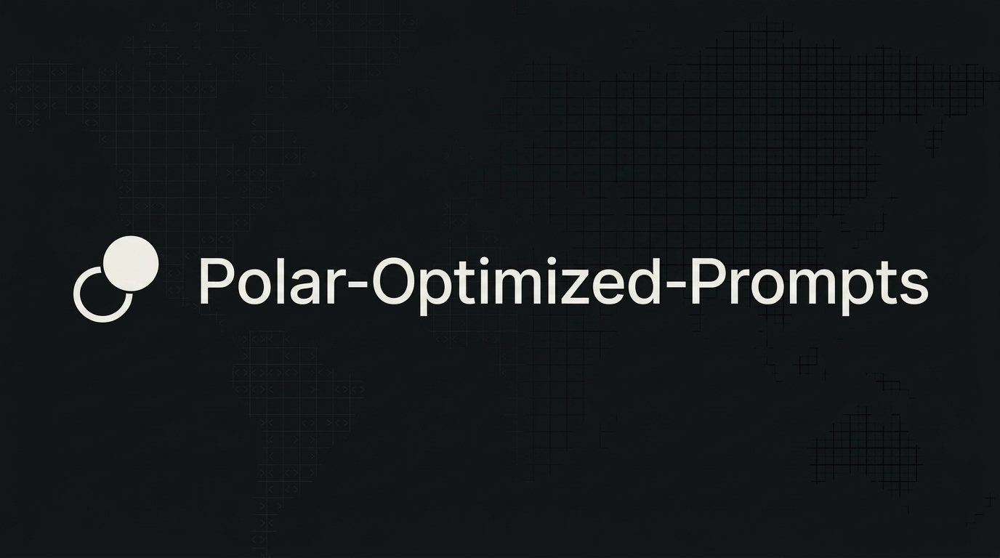

  

<h1 align="center">Polar-Optimized Prompts</h1>
<h3 align="center">By Scott Malin — Cybersecurity & Automation Architect</h3>

Experimental prompt variations tuned for the Polar browser. 
Testing how structured AI frameworks behave when optimized for Polar’s environment.

  
  
  
  
  
  

---

# 📘 Overview

This repository is a **sandbox for Polar-optimized prompt experiments**.

I’m testing variations of existing frameworks (job-search intelligence, scam detection, LinkedIn tools, etc.) to see how they perform when tuned specifically for the Polar browser. These are not yet production-hardened — they’re working drafts and comparison points against the main prompt libraries.

**Current focus areas:**
- Job posting intelligence and scanning
- Scam / conversation helper patterns
- LinkedIn canonical mirroring
- Structured JSON output reliability under Polar

---

# 📁 Current Experiments

| File | Purpose |
|------|---------|
| `Customizable Job Scanner - Optimized for Polar.md` | Job scanner variant tuned for Polar |
| `Job Posting Intelligence Engine (JSON Branch) - Optimized for Polar.md` | High-density JSON job posting analysis |
| `LinkedIn Canonical Mirror Engine - JSON - Optimized for Polar.md` | LinkedIn profile/resume consistency engine |
| `Scam Detection Conversation Helper - Polar optimized.md` | Scam detection conversation framework |

---

# 🔗 Related Repos

- 💼 [Job Search & Career Prompts](https://github.com/scottmalin68-commits/Job-Search-Career-Prompts)
- 🛡️ [Cybersecurity Prompts](https://github.com/scottmalin68-commits/Cybersecurity-Prompts)
- 🧩 [Misc AI Prompts](https://github.com/scottmalin68-commits/Misc-AI-Prompts)
- 🧭 [Profile](https://github.com/scottmalin68-commits)

---

# 📜 License

MIT License — see `LICENSE` for details.
